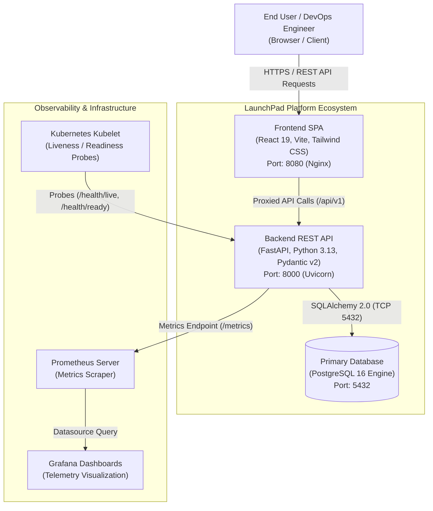
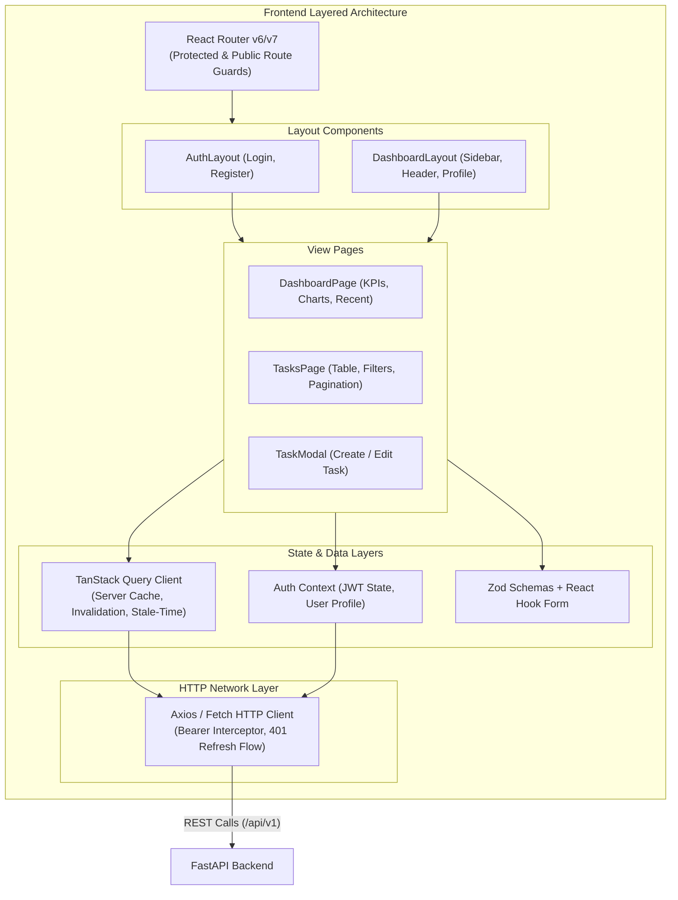
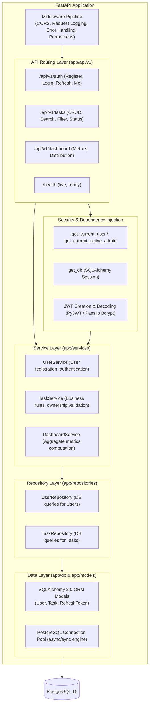
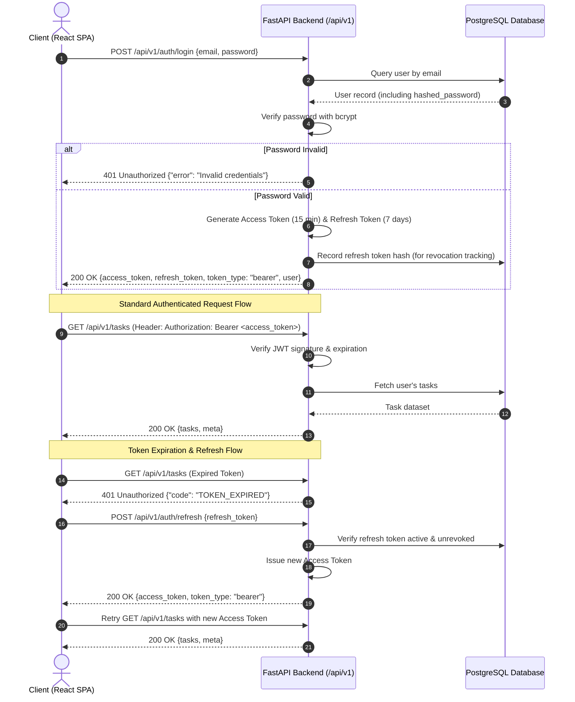
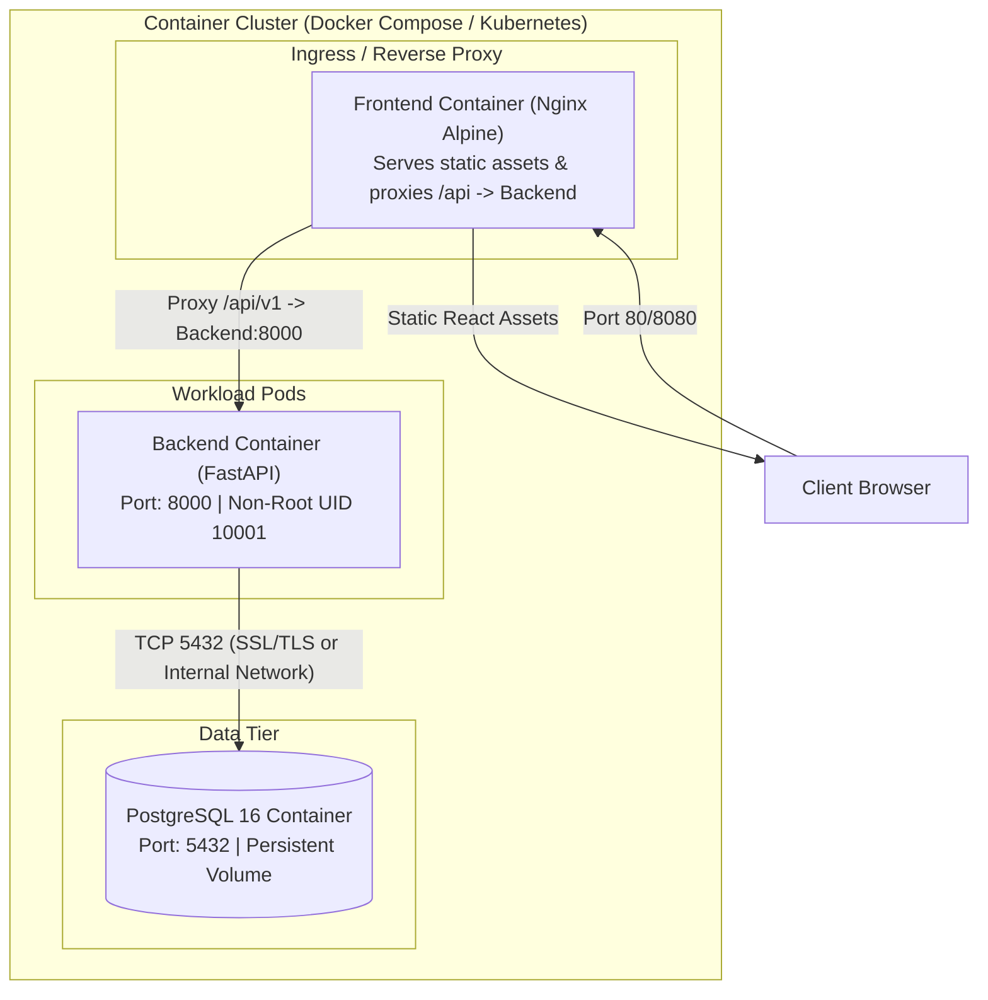

# LaunchPad Platform - System Architecture Specification (Phase 2)

**Document Version:** 1.0.0  
**Date:** November 2026  
**Status:** Approved  
**Author:** Senior Architecture & DevSecOps Engineering Team  

---

## 1. System Context & Overview

The **LaunchPad Platform** is an enterprise-grade cloud-native task management application built to demonstrate production-level software engineering, microservice containerization, and modern GitOps/DevOps practices.

### 1.1 High-Level System Context (C4 Context)



---

## 2. Frontend Architecture

The frontend is a modern Single Page Application (SPA) developed with **React 19**, **TypeScript 5+**, **Vite**, and **Tailwind CSS**. It is structured according to clear architectural boundaries separating presentational components, business hooks, API service communication, and routing state.

### 2.1 Component & Data Flow Hierarchy



### 2.2 Frontend Directory Structure
```
application/frontend/
├── src/
│   ├── assets/            # Static image assets and SVGs
│   ├── components/        # Reusable UI component library
│   │   ├── ui/            # Atomic primitives: Button, Input, Select, Badge, Card, Modal
│   │   ├── layout/        # Sidebar, Navbar, Breadcrumbs, Layout wrapper
│   │   └── tasks/         # TaskCard, TaskTable, TaskFilters, TaskFormModal
│   ├── context/           # AuthContext, ThemeContext
│   ├── hooks/             # Custom hooks (useTasks, useDashboard, useAuth)
│   ├── layouts/           # AuthLayout, AppLayout
│   ├── pages/             # Login, Register, Dashboard, Tasks, Profile, NotFound
│   ├── services/          # apiClient.ts, authService.ts, taskService.ts
│   ├── types/             # TypeScript type definitions (Task, User, API payloads)
│   ├── utils/             # Formatting (dates, status badges, priority colors)
│   ├── App.tsx            # Root application router setup
│   ├── index.css          # Tailwind CSS directives & custom design tokens
│   └── main.tsx           # Entrypoint with QueryClientProvider & AuthProvider
├── tailwind.config.js     # Tailwind CSS theme configuration
└── vite.config.ts         # Vite build and dev server configuration
```

---

## 3. Backend Architecture

The backend is built with **FastAPI** on **Python 3.13**, implementing a clean, modular, layered architecture with dependency injection.

### 3.1 Layered Backend Architecture



### 3.2 Backend Modular Structure
```
application/backend/
├── app/
│   ├── api/
│   │   └── v1/
│   │       ├── endpoints/
│   │       │   ├── auth.py          # Authentication & token endpoints
│   │       │   ├── tasks.py         # Task CRUD, filters, pagination
│   │       │   ├── dashboard.py     # Aggregated metric summaries
│   │       │   └── health.py        # K8s liveness & readiness probes
│   │       └── router.py            # API v1 consolidated router
│   ├── core/
│   │   ├── config.py                # Pydantic BaseSettings environment config
│   │   ├── security.py              # Password hashing & JWT token operations
│   │   └── logging.py               # Structured JSON logger configuration
│   ├── db/
│   │   ├── base.py                  # DeclarativeBase metadata
│   │   └── session.py               # SQLAlchemy engine & session factory
│   ├── middleware/
│   │   ├── error_handler.py         # Centralized exception translation
│   │   └── request_id.py            # Correlation ID injection
│   ├── models/
│   │   ├── base.py                  # Abstract base model with ID & timestamps
│   │   ├── user.py                  # User SQLAlchemy model
│   │   └── task.py                  # Task SQLAlchemy model
│   ├── repositories/
│   │   ├── base.py                  # Generic repository CRUD pattern
│   │   ├── user_repo.py             # User SQL persistence methods
│   │   └── task_repo.py             # Task SQL query and filter methods
│   ├── schemas/
│   │   ├── auth.py                  # Token and Login Pydantic schemas
│   │   ├── user.py                  # User create/read Pydantic schemas
│   │   ├── task.py                  # Task request/response Pydantic schemas
│   │   └── common.py                # Pagination and Error envelope schemas
│   ├── services/
│   │   ├── auth_service.py          # Authentication business logic
│   │   ├── task_service.py          # Task business operations & validations
│   │   └── dashboard_service.py     # Aggregation & metric calculations
│   └── main.py                      # FastAPI application entrypoint
├── alembic/                         # Database migration scripts
├── tests/                           # Pytest unit and integration test suite
├── requirements.txt                 # Pinned Python package dependencies
├── pyproject.toml                   # Tool configurations (Ruff, Pytest)
├── alembic.ini                      # Alembic migration configuration
└── Dockerfile                       # Multi-stage production Dockerfile
```

---

## 4. Authentication & Security Architecture

### 4.1 Token Lifecycle & Refresh Flow (Sequence Diagram)



---

## 5. Container & Cloud Deployment Topology



---

## 6. Architecture Quality & Governance Verification

1. **Separation of Concerns:** Zero SQL code in API route handlers; business logic strictly isolated inside `services/`; database access encapsulated inside `repositories/`.
2. **Type Safety:** 100% end-to-end typing from PostgreSQL database models to Pydantic schemas on the backend, and TypeScript interfaces on the frontend.
3. **Defense in Depth:** Least-privilege containers, non-root execution, parameterized queries, short-lived tokens, secure password hashing, and origin-restricted CORS.
