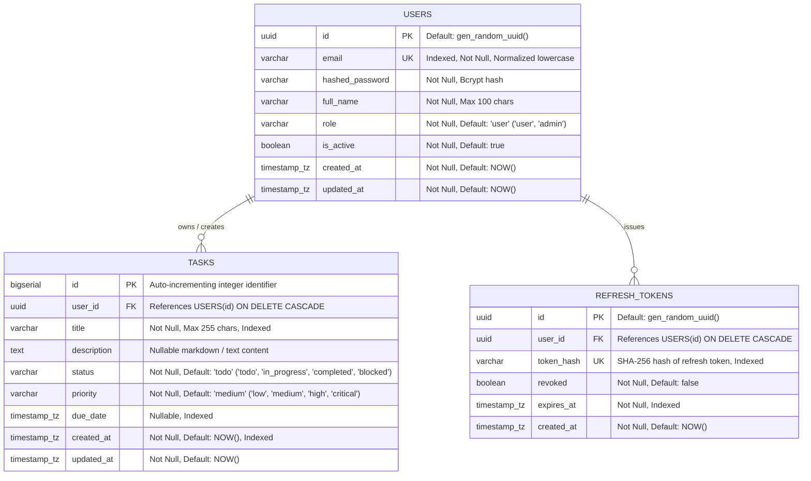

# LaunchPad Platform - Database Design & Schema Specification (Phase 2)

**Document Version:** 1.0.0  
**Date:** November 2026  
**Status:** Approved  
**Author:** Senior Architecture & DevSecOps Engineering Team  

---

## 1. Database Architecture Overview

The **LaunchPad Task Manager** relies on **PostgreSQL 16** as its primary relational database. PostgreSQL was selected for its robust ACID compliance, advanced indexing capabilities (B-tree, GIN), rich constraint enforcement, and first-class cloud-native support.

All database schema definition and migration is managed strictly via **SQLAlchemy 2.0 ORM** and **Alembic**. Direct table manipulation or reliance on runtime `metadata.create_all()` in production environments is forbidden.

---

## 2. Entity-Relationship Diagram (ERD)



---

## 3. Detailed Table Specifications

### 3.1 Table: `users`
Represents registered system users and administrators.

| Column Name | Data Type | Nullable | Default | Constraints & Indexes | Description |
|---|---|---|---|---|---|
| `id` | `UUID` | No | `gen_random_uuid()` | Primary Key | Globally unique user identifier |
| `email` | `VARCHAR(255)` | No | None | Unique, Index (`ix_users_email`) | User login email (case-insensitive) |
| `hashed_password` | `VARCHAR(255)` | No | None | None | Bcrypt password hash string |
| `full_name` | `VARCHAR(100)` | No | None | None | User's full display name |
| `role` | `VARCHAR(20)` | No | `'user'` | Check (`role IN ('user', 'admin')`) | Role for authorization checks |
| `is_active` | `BOOLEAN` | No | `TRUE` | None | Account status indicator |
| `created_at` | `TIMESTAMPTZ` | No | `CURRENT_TIMESTAMP` | None | Record creation timestamp |
| `updated_at` | `TIMESTAMPTZ` | No | `CURRENT_TIMESTAMP` | None | Record last modification timestamp |

### 3.2 Table: `tasks`
Stores individual work items, metadata, status, priority, and deadlines.

| Column Name | Data Type | Nullable | Default | Constraints & Indexes | Description |
|---|---|---|---|---|---|
| `id` | `BIGSERIAL` | No | Auto | Primary Key | Task identifier |
| `user_id` | `UUID` | No | None | Foreign Key (`users.id`), Index | Owner of the task (`ON DELETE CASCADE`) |
| `title` | `VARCHAR(255)` | No | None | Index (`ix_tasks_title`) | Brief task title |
| `description` | `TEXT` | Yes | `NULL` | None | Detailed task description |
| `status` | `VARCHAR(30)` | No | `'todo'` | Index, Check constraint | Current status (`todo`, `in_progress`, `completed`, `blocked`) |
| `priority` | `VARCHAR(20)` | No | `'medium'` | Index, Check constraint | Priority level (`low`, `medium`, `high`, `critical`) |
| `due_date` | `TIMESTAMPTZ` | Yes | `NULL` | Index (`ix_tasks_due_date`) | Scheduled completion deadline |
| `created_at` | `TIMESTAMPTZ` | No | `CURRENT_TIMESTAMP` | Index (`ix_tasks_created_at`) | Creation timestamp |
| `updated_at` | `TIMESTAMPTZ` | No | `CURRENT_TIMESTAMP` | None | Last modification timestamp |

### 3.3 Table: `refresh_tokens`
Tracks issued refresh tokens for secure rotation and revocation.

| Column Name | Data Type | Nullable | Default | Constraints & Indexes | Description |
|---|---|---|---|---|---|
| `id` | `UUID` | No | `gen_random_uuid()` | Primary Key | Token identifier |
| `user_id` | `UUID` | No | None | Foreign Key (`users.id`), Index | User associated with the session |
| `token_hash` | `VARCHAR(64)` | No | None | Unique, Index | SHA-256 hash of the token secret |
| `revoked` | `BOOLEAN` | No | `FALSE` | Index (`ix_refresh_tokens_revoked`) | Flag indicating manual or security revocation |
| `expires_at` | `TIMESTAMPTZ` | No | None | Index (`ix_refresh_tokens_expires_at`)| Token expiration timestamp |
| `created_at` | `TIMESTAMPTZ` | No | `CURRENT_TIMESTAMP` | None | Token issuance timestamp |

---

## 4. Indexing & Query Optimization Strategy

Efficient query execution is guaranteed through purpose-built indexes:

1. **User Lookup:**
   - `CREATE UNIQUE INDEX ix_users_email ON users(email);`
2. **User-Scoped Task Filtering (Composite Indexes):**
   - `CREATE INDEX ix_tasks_user_status ON tasks(user_id, status);`
   - Accelerates dashboard counts and tabbed task filtering (`WHERE user_id = :uid AND status = :st`).
3. **Deadline & Overdue Queries:**
   - `CREATE INDEX ix_tasks_user_due_date ON tasks(user_id, due_date) WHERE status != 'completed';`
   - Filtered partial index specifically targeting pending/overdue task calculations.
4. **Pagination & Sorting:**
   - `CREATE INDEX ix_tasks_user_created_at ON tasks(user_id, created_at DESC);`
   - Eliminates sort-buffer overhead on default reverse-chronological task listings.

---

## 5. Connection Pooling & Transaction Management

SQLAlchemy 2.0 manages database connections via standard `QueuePool`:

```python
engine = create_engine(
    DATABASE_URL,
    pool_size=10,         # Minimum steady-state pool connections
    max_overflow=20,      # Maximum burst connections allowed
    pool_timeout=30,      # Seconds to wait before raising TimeoutError
    pool_recycle=1800,    # Recycle connections older than 30 minutes
    pool_pre_ping=True,   # Execute test SELECT 1 before vending connection
)
```

### Transaction Boundary Rules
- Every API request obtains a clean database session via FastAPI's `get_db` dependency.
- Read operations execute within default auto-managed transactions.
- Write operations commit explicitly on success, and roll back automatically on unhandled exceptions via standard context management.
