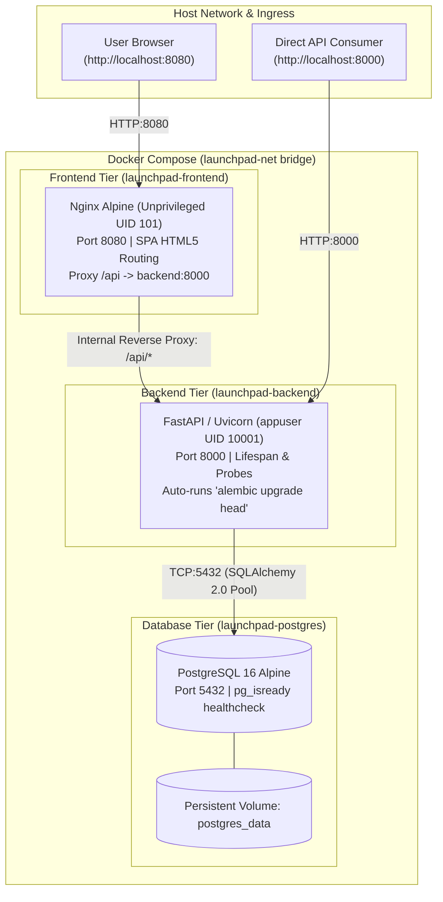

# LaunchPad Platform - Docker & Containerization Runbook (Phase 8)

**Document Version:** 1.0.0  
**Date:** November 2026  
**Status:** Approved  
**Author:** Senior Architecture & DevSecOps Engineering Team  

---

## 1. Overview & Multi-Container Topology

The **LaunchPad Platform** is fully containerized using cloud-native Docker best practices. The local and staging environment runs as an isolated three-tier microservice architecture managed through **Docker Compose**:



---

## 2. Container Hardening & Security Standards

Every container in this platform implements production security guardrails:

| Security Practice | Backend Container | Frontend Container | PostgreSQL Container |
|---|---|---|---|
| **Non-Root Execution** | Runs as `appuser` (`UID 10001`) | Runs as `nginx` (`UID 101`) | Runs as `postgres` (`UID 70`) |
| **Multi-Stage Build** | Stage 1 (builder) -> Stage 2 (slim runner) | Stage 1 (node:22) -> Stage 2 (nginx-alpine) | Official hardened Alpine image |
| **Attack Surface** | Excludes compilers and dev tools in runner | Zero Node.js runtime in production | Minimal Alpine footprint |
| **Secret Hygiene** | Injected strictly via environment variables | No secrets baked in HTML/JS assets | Injected via environment variables |
| **Health Checks** | Native `curl -f /health/live` | Native `wget -qO- /health` | Native `pg_isready` |

---

## 3. Quickstart: Running with Docker Compose

### 3.1 Prerequisites
- Docker Engine `>= 24.0.0`
- Docker Compose `>= v2.20.0`

### 3.2 Setup & Startup
From the repository root:

```bash
# 1. Copy environment template
cp .env.example .env

# 2. Build and launch all services in detached mode
docker compose up --build -d
```

### 3.3 Verifying Service Health
```bash
docker compose ps
```
All three services should show `Up` and `healthy`:
```
NAME                 IMAGE                      COMMAND                  STATUS
launchpad-postgres   postgres:16-alpine         "docker-entrypoint.s…"   Up (healthy)
launchpad-backend    launchpad-platform-backend "/app/entrypoint.sh …"   Up (healthy)
launchpad-frontend   launchpad-platform-frontend "/docker-entrypoint…"   Up (healthy)
```

### 3.4 Accessing Application Services
- **Frontend SPA Interface:** `http://localhost:8080`
- **Backend API Documentation (Swagger UI):** `http://localhost:8000/docs`
- **Backend ReDoc:** `http://localhost:8000/redoc`
- **Prometheus Metrics Scraper:** `http://localhost:8000/metrics`
- **Liveness Probe:** `http://localhost:8000/health/live`
- **Readiness Probe:** `http://localhost:8000/health/ready`

---

## 4. Teardown & Maintenance Operations

### 4.1 Stopping Services
Stop running containers without destroying database volume data:
```bash
docker compose stop
```

Stop and remove containers and network:
```bash
docker compose down
```

### 4.2 Resetting Database State (Complete Teardown)
To completely delete the database and start with a fresh volume:
```bash
docker compose down -v
```

### 4.3 Inspecting Container Logs
```bash
# Follow all logs
docker compose logs -f

# Follow specific service logs
docker compose logs -f backend
docker compose logs -f frontend
docker compose logs -f postgres
```

### 4.4 Running Migrations Inside Running Backend Container
```bash
docker compose exec backend alembic upgrade head
```

---

## 5. Troubleshooting Common Issues

| Issue | Root Cause | Resolution |
|---|---|---|
| **Port Conflict (`bind: address already in use`)** | Another process is using port 5432, 8000, or 8080 on the host. | Check ports with `netstat -ano \| findstr :5432` and terminate conflicting service, or change host port mappings in `.env` or `docker-compose.yml`. |
| **Backend Wait Timeout on Startup** | PostgreSQL container is still initializing data directory. | The backend `depends_on` rule uses `condition: service_healthy` with a 10s start period, ensuring PostgreSQL is accepting TCP connections before backend startup. |
| **Frontend 502 Bad Gateway on `/api/`** | Backend container is restarting or failing health check. | Run `docker compose logs backend` to inspect backend initialization logs. |
